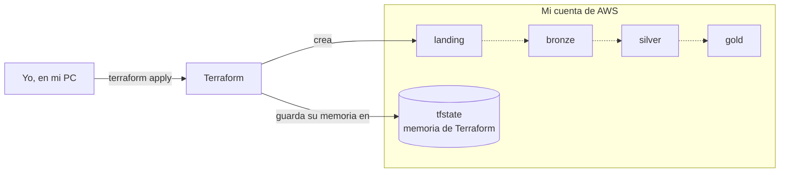

# terraform-multicloud

Mi laboratorio para aprender **Terraform con AWS** desde cero.

En este proyecto creé **4 "carpetas en la nube" (buckets S3)** usando código, en vez de crearlas a mano haciendo clic en la consola de AWS. Esas 4 carpetas forman un **data lake**: un lugar donde se guardan datos en distintas etapas de limpieza.

---

## Índice

1. [Conceptos básicos (léelo primero)](#1-conceptos-básicos-léelo-primero)
2. [Qué construí](#2-qué-construí)
3. [Cómo está ordenado el proyecto](#3-cómo-está-ordenado-el-proyecto)
4. [Paso 1: preparar la cuenta de AWS](#4-paso-1-preparar-la-cuenta-de-aws)
5. [Paso 2: instalar las herramientas](#5-paso-2-instalar-las-herramientas)
6. [Paso 3: conectarme a AWS desde la terminal](#6-paso-3-conectarme-a-aws-desde-la-terminal)
7. [Paso 4: mi primer código de Terraform](#7-paso-4-mi-primer-código-de-terraform)
8. [Paso 5: entender el state](#8-paso-5-entender-el-state)
9. [Paso 6: ordenar el proyecto como un profesional](#9-paso-6-ordenar-el-proyecto-como-un-profesional)
10. [Paso 7: desplegar los 4 buckets](#10-paso-7-desplegar-los-4-buckets)
11. [Paso 8: borrar todo](#11-paso-8-borrar-todo)
12. [Paso 9: guardar el state en S3 (state remoto)](#12-paso-9-guardar-el-state-en-s3-state-remoto)
13. [Paso 10: subir mi código a GitHub](#13-paso-10-subir-mi-código-a-github)
14. [Paso 11: ordenar los módulos por nube](#14-paso-11-ordenar-los-módulos-por-nube)
15. [Errores que tuve y cómo los resolví](#15-errores-que-tuve-y-cómo-los-resolví)
16. [Comandos de memoria](#16-comandos-de-memoria)
17. [Qué sigue](#17-qué-sigue)

---

## 1. Conceptos básicos (léelo primero)

| Palabra | Qué significa, en simple |
|---|---|
| **AWS** | La nube de Amazon. Te alquila servidores, almacenamiento, bases de datos, etc. |
| **Bucket S3** | Una **carpeta en la nube** de AWS donde guardas archivos. |
| **Terraform** | Una herramienta que **crea cosas en la nube a partir de un archivo de texto**. Escribes lo que quieres y Terraform lo crea. |
| **Infraestructura como código (IaC)** | Crear la infraestructura escribiendo código en vez de hacer clics. Si se borra todo, lo vuelves a crear igual con el mismo código. |
| **Data lake** | Un lugar donde se guardan muchos datos. |
| **Capas medallion** | Etapas de los datos: **landing** (llegan tal cual), **bronze** (copia cruda), **silver** (limpios), **gold** (listos para reportes). |
| **IAM** | El sistema de AWS que controla **quién entra y qué puede hacer**. |
| **MFA** | El código de 6 dígitos del celular que se pide además de la contraseña. |
| **Access key** | Una "llave" permanente para usar AWS sin contraseña. **No la usamos** (ver paso 3). |
| **Perfil (profile)** | Un nombre para guardar una forma de conectarse a AWS. El mío se llama `iac-admin`. |
| **Región** | El lugar del mundo donde AWS guarda tus cosas. Uso `us-east-1` (Virginia, EE. UU.). |
| **Versionado** | Cuando está activo, S3 **nunca borra de verdad** un archivo: guarda las versiones anteriores escondidas. Sirve para recuperar cosas, pero hace que un bucket "parezca vacío" sin estarlo (ver [Paso 8](#11-paso-8-borrar-todo)). |

**La idea de Terraform en una frase:** *escribes en un archivo cómo quieres que quede tu nube, y Terraform se encarga de que quede así.*

---

## 2. Qué construí



4 buckets, uno por capa:

| Capa | Nombre del bucket |
|---|---|
| landing | `s3use1lablandingd01` |
| bronze | `s3use1labbronzed01` |
| silver | `s3use1labsilverd01` |
| gold | `s3use1labgoldd01` |

Y un bucket extra para la **memoria de Terraform** (el state):

| Para qué | Nombre del bucket |
|---|---|
| Guardar el state | `s3use1labtfstated01` |

Cada bucket viene **protegido** automáticamente:
- **Nadie de internet puede verlo** (bloqueo de acceso público).
- **Los archivos se guardan cifrados.**
- **Solo acepta conexiones seguras (HTTPS).**
- **Guarda versiones anteriores** de los archivos, por si alguien borra algo por error.

---

## 3. Cómo está ordenado el proyecto

```
terraform-multicloud/
├── envs/                  ← los VALORES de cada ambiente
│   ├── d.tfvars           ← valores de desarrollo
│   └── d.backend.hcl      ← dónde se guarda el state en desarrollo
├── modules/               ← las PLANTILLAS, separadas por nube
│   └── aws/
│       └── s3-bucket/     ← plantilla de "un bucket bien hecho"
├── stacks/                ← lo que se DESPLIEGA
│   └── aws/
│       ├── 00-bootstrap/  ← crea el bucket del state (se corre una sola vez)
│       └── 10-datalake/   ← usa la plantilla 4 veces (su state vive en S3)
├── .gitignore             ← archivos que NO se suben a GitHub
└── readme.md              ← este archivo
```

**Una analogía con una fábrica de galletas:**

| Carpeta | En la fábrica | En el proyecto |
|---|---|---|
| `modules/` | El **molde** de la galleta | Cómo se hace un bucket seguro |
| `stacks/` | La **orden de producción**: "haz 4 galletas" | "Crea 4 buckets: landing, bronze, silver, gold" |
| `envs/` | El **sabor** de cada tanda | Los valores de desarrollo, certificación o producción |

El molde se hace **una vez** y se usa muchas veces.

**¿Por qué hay una carpeta `aws/` dentro de `modules/` y de `stacks/`?** Porque el proyecto va a crecer a **Azure** y **GCP**. Cada nube tiene sus propias plantillas y sus propios despliegues, y así no se mezclan:

```
modules/aws/s3-bucket/          stacks/aws/10-datalake/
modules/azure/...   (futuro)    stacks/azure/...   (futuro)
modules/gcp/...     (futuro)    stacks/gcp/...     (futuro)
```

**¿Por qué `10-datalake` tiene un número?** Indica el **orden**. Más adelante habrá `20-...`, `30-...`, y cada uno se despliega después del anterior porque lo necesita. Se numera de 10 en 10 para poder meter otro en medio (por ejemplo `15-...`) sin renombrar todo.

---

## 4. Paso 1: preparar la cuenta de AWS

Cuando creas una cuenta de AWS, entras con el **usuario root** (el dueño). Es como la llave maestra de la casa: **no se usa todos los días**.

Lo que hice:
1. **Le puse MFA al root** (código del celular).
2. **Creé un grupo** llamado `grp-iac-admins` con permisos de administrador.
3. **Creé mi usuario de trabajo** `iac-admin` y lo metí en ese grupo.
4. **Le puse MFA a `iac-admin`**. Cada usuario necesita su propio MFA.

> **¿Por qué?** Si alguien roba la contraseña del root, se queda con todo. Usando otro usuario para el día a día, el root queda guardado y seguro.

> **¿Por qué el nombre `iac-admin` y no mi nombre?** En empresas los usuarios técnicos se nombran por **lo que hacen**, no por la persona. `iac` = infraestructura como código.

---

## 5. Paso 2: instalar las herramientas

Necesitas dos programas:
- **Terraform**: el que crea la infraestructura.
- **AWS CLI**: el que conecta tu terminal con AWS.

En Windows se instalan con `winget` (el instalador de Windows por comandos).

**Ver qué versiones hay:**
```bash
winget show --id Hashicorp.Terraform --versions
winget show --id Amazon.AWSCLI --versions
```

**Instalar una versión fija:**
```bash
winget install --id Hashicorp.Terraform -e --version 1.17.1
winget install --id Amazon.AWSCLI -e --version 2.41.1
```

**Cerrar la terminal, abrirla de nuevo y comprobar:**
```bash
terraform -version
aws --version
```

> **¿Qué versión elegir?** Las versiones tienen 3 números: `1.17.1` = mayor . menor . **parche**. El parche solo corrige errores. Conviene el parche más alto y **evitar las que terminan en `.0`**, porque son las primeras y suelen traer bugs.

---

## 6. Paso 3: conectarme a AWS desde la terminal

```bash
aws login --profile iac-admin
```

1. Si pregunta la región, presiono **Enter** (`us-east-1`).
2. Se abre el navegador. Elijo **"Sign into new session"** (¡no la sesión del root!).
3. Entro con `iac-admin`, su contraseña y el código MFA.
4. Si pregunta por "AWS skills / MCP server", respondo `n`.

**Comprobar con quién estoy conectado:**
```bash
aws sts get-caller-identity --profile iac-admin
```
Al final del `Arn` tiene que decir `user/iac-admin`.

> **Si después de unas horas sale un error `ExpiredToken`**, la sesión venció. Vuelve a correr `aws login --profile iac-admin`.

### ¿Por qué no uso access keys?

Mi profesor del curso creó una **access key**. Era lo normal en cursos antiguos, pero hoy **no es la buena práctica**:

| | Access key | `aws login` |
|---|---|---|
| ¿Cuánto dura? | Para siempre | Unas horas |
| ¿Pide el código del celular? | No | Sí |
| ¿Dónde queda? | En un archivo de texto en tu PC | Se renueva solo al iniciar sesión |
| Si alguien la roba… | Tiene acceso total hasta que la borres | Deja de servir en poco tiempo |

**Ejemplo real:** hay robots que buscan access keys subidas por error a GitHub. Si encuentran una con permisos de administrador, crean servidores para minar criptomonedas y llega una factura de miles de dólares.

**En las empresas:**
- Las **personas** entran con su usuario y MFA (`aws login` o `aws sso login`).
- Los **programas y pipelines** usan **roles**, nunca llaves guardadas.

---

## 7. Paso 4: mi primer código de Terraform

### Las 3 palabras clave

| Palabra | Qué hace | Ejemplo de la vida real |
|---|---|---|
| `provider` | **Se conecta** a la nube | Entrar a la banca por internet |
| `data` | **Consulta** algo que ya existe | Ver tu número de cuenta |
| `resource` | **Crea** algo | Hacer una transferencia |

### Ejemplo de un bucket
```hcl
provider "aws" {
  region  = "us-east-1"
  profile = "iac-admin"
}

resource "aws_s3_bucket" "landing" {
  bucket = "s3use1lablandingd01"
}
```

Se lee así:
- `provider "aws"`: *"conéctate a AWS, en us-east-1, con mi perfil iac-admin"*.
- `resource "aws_s3_bucket" "landing"`: *"crea un bucket S3; dentro de mi código lo llamo `landing`"*.
- `bucket = "..."`: el nombre real del bucket en AWS.

### Regla de escritura
- **Bloques** (`provider`, `resource`, `data`, `variable`) → **sin** `=` → `resource "tipo" "nombre" { }`
- **Valores dentro de un bloque** → **con** `=` → `bucket = "mi-bucket"`

### Variables
Una **variable** es un valor que puedes cambiar sin tocar el resto del código:
```hcl
variable "region" {
  description = "Región de AWS"
  type        = string
  default     = "us-east-1"
}
```
Y se usa así: `var.region`.

### El ciclo de Terraform (siempre en este orden)

| Paso | Comando | Qué hace | ¿Cambia algo en AWS? |
|---|---|---|---|
| 1 | `terraform init` | Prepara la carpeta y descarga lo necesario | No |
| 2 | `terraform fmt` | Ordena el código (espacios, alineación) | No |
| 3 | `terraform validate` | Revisa que no haya errores de escritura | No |
| 4 | `terraform plan` | **Muestra** lo que va a hacer, sin hacerlo | No |
| 5 | `terraform apply` | **Lo hace de verdad** (pide escribir `yes`) | **Sí** |

### Cómo leer el `plan`
- `+` verde = se va a **crear**
- `~` amarillo = se va a **modificar**
- `-` rojo = se va a **borrar**
- `(known after apply)` = un dato que AWS asigna recién al crearlo

> **Regla de oro:** **nunca hagas `apply` sin leer el `plan`.**

---

## 8. Paso 5: entender el state

Después del primer `apply` apareció un archivo **`terraform.tfstate`**. Es la **memoria de Terraform**: ahí anota todo lo que creó.

```
Mi código dice:   "quiero un bucket llamado landing"
El state anota:   "landing" = el bucket s3use1lablandingd01 de AWS
```

Cada vez que corres `plan`, Terraform:
1. Lee **tu código** (lo que quieres).
2. Lee **el state** (lo que cree que existe).
3. Le pregunta **a AWS** (lo que existe de verdad).
4. Te muestra la diferencia.

Si corres `plan` sin cambiar nada, dice **"No changes"**. Puedes correr `apply` 100 veces y no crea 100 buckets: siempre deja la nube igual a tu código.

**Comandos para ver el state** (sin abrir el archivo):
```bash
terraform state list                          # qué recursos administra
terraform state show <recurso>                # el detalle de uno
```

> ⚠️ **Nunca edites el state a mano ni lo subas a GitHub.** Puede tener datos sensibles.
>
> 💡 Al principio el state estaba en mi PC. En el [Paso 9](#12-paso-9-guardar-el-state-en-s3-state-remoto) lo moví a S3.
>
> ⚠️ **Nunca borres la carpeta del proyecto sin hacer antes `terraform destroy`.** Me pasó: borré la carpeta, el state se perdió y el bucket quedó "huérfano" en AWS. Tuve que borrarlo a mano.

---

## 9. Paso 6: ordenar el proyecto como un profesional

Al principio todo estaba en un solo archivo. Lo separé así:

### La plantilla: `modules/aws/s3-bucket/`

| Archivo | Para qué sirve |
|---|---|
| `variables.tf` | Lo que la plantilla **recibe** (como los parámetros de una función). El principal: `bucket_name`. |
| `main.tf` | Lo que la plantilla **crea**: el bucket y sus protecciones. |
| `outputs.tf` | Lo que la plantilla **devuelve**: el nombre y el ARN del bucket. |
| `versions.tf` | Qué versión mínima del provider necesita (`>= 6.0`). |

Lo que crea por cada bucket (6 piezas):

| Pieza | En simple |
|---|---|
| `aws_s3_bucket` | El bucket |
| `aws_s3_bucket_public_access_block` | Candado: nadie de internet puede entrar |
| `aws_s3_bucket_ownership_controls` | Apaga un sistema de permisos antiguo y confuso |
| `aws_s3_bucket_server_side_encryption_configuration` | Guarda los archivos cifrados |
| `aws_s3_bucket_policy` | Rechaza conexiones que no sean seguras (HTTPS) |
| `aws_s3_bucket_versioning` | Guarda versiones anteriores de los archivos |

### El despliegue: `stacks/aws/10-datalake/`

| Archivo | Para qué sirve |
|---|---|
| `versions.tf` | Fija la versión de Terraform (1.17.x) y del provider (6.x) |
| `providers.tf` | Cómo conectarse a AWS y qué etiquetas poner a todo |
| `variables.tf` | Los valores que se pueden cambiar (región, proyecto, ambiente, responsable) |
| `locals.tf` | **Arma los nombres** de los buckets automáticamente |
| `main.tf` | **Usa la plantilla 4 veces**, una por capa |
| `outputs.tf` | Muestra al final el nombre de cada bucket |

### Cómo se arma el nombre de un bucket
```
s3 + use1 + lab + landing + d + 01  =  s3use1lablandingd01
│    │      │     │         │   └── número
│    │      │     │         └────── ambiente: d = desarrollo, c = certificación, p = producción
│    │      │     └──────────────── capa
│    │      └────────────────────── proyecto
│    └───────────────────────────── región (us-east-1)
└────────────────────────────────── tipo: bucket S3
```
Si cambio el ambiente a `p`, los 4 nombres cambian solos a `...p01`.

### Cómo la plantilla se usa 4 veces (`for_each`)
```hcl
module "buckets" {
  source   = "../../../modules/aws/s3-bucket"   # dónde está la plantilla
  for_each = local.buckets                  # repetir una vez por cada capa

  bucket_name = each.value                  # el nombre de esa capa
}
```
`for_each` es como un bucle: "para cada capa, crea un bucket con la plantilla".

### Los valores del ambiente: `envs/d.tfvars`
```hcl
region      = "us-east-1"
project     = "lab"
environment = "d"
owner       = "Jason-Cb"
```
Para producción se haría otro archivo `p.tfvars` con `environment = "p"`. **El código es el mismo; solo cambia este archivo.**

### `.gitignore`: lo que nunca se sube a GitHub
```
.terraform/        # programas descargados (muy pesados)
*.tfstate          # la memoria de Terraform
*.tfstate.*
*.tfvars           # valores (pueden tener secretos)...
!envs/*.tfvars     # ...excepto los de envs/, que no tienen secretos
tfplan             # el plan guardado
crash.log
.env
*csv               # por ejemplo, el CSV con la contraseña de AWS
*credentials*
```

---

## 10. Paso 7: desplegar los 4 buckets

```bash
# 1. Ir a la carpeta del despliegue
cd stacks/aws/10-datalake

# 2. Decir con qué perfil trabajar y comprobar la sesión
export AWS_PROFILE=iac-admin
aws sts get-caller-identity

# 3. Preparar la carpeta (desde el Paso 9, siempre con el backend)
terraform init -backend-config="../../../envs/d.backend.hcl"

# 4. Ordenar y revisar el código
terraform fmt -recursive ../../../
terraform validate

# 5. Ver qué va a hacer y guardarlo en un archivo
terraform plan -var-file="../../../envs/d.tfvars" -out=tfplan

# 6. Hacerlo
terraform apply tfplan
```

**Qué significa cada parte nueva:**
- `-var-file="../../../envs/d.tfvars"`: *"usa los valores de desarrollo"*. Cada `../` sube una carpeta.
- `-out=tfplan`: guarda el plan en un archivo, para que el `apply` haga **exactamente** lo que revisaste.
- `apply tfplan`: aplica ese plan guardado. No pide `yes` porque ya lo revisaste.

**Resultado esperado:** `Plan: 24 to add` → 4 buckets × 6 piezas cada uno.

---

## 11. Paso 8: borrar todo

> ⚠️ **Lee esto primero: con el versionado, S3 no borra los archivos de verdad.**
>
> Si un bucket tiene **versionado activado**, cada vez que un archivo se sobrescribe o se elimina, S3 **guarda la versión anterior escondida**. El archivo desaparece de la lista, pero sigue ahí ocupando espacio.
>
> ```
> terraform.tfstate
> ├── versión actual      ← la que ves en la lista
> ├── versión anterior    ← escondida (de un apply anterior)
> ├── versión anterior    ← escondida
> └── ...
> ```
>
> Por eso un bucket puede **verse vacío y no estarlo**. Para verlas: entra al bucket y activa **Show versions**.
>
> - Si borras un archivo a mano, S3 no lo elimina: le pone una **marca de borrado** (*delete marker*) y guarda todas sus versiones.
> - El botón **Empty** de la consola borra **todo**: archivos, versiones anteriores y marcas de borrado.
>
> Esto es justamente lo que permite **recuperar un state dañado**: se vuelve a una de esas versiones escondidas.

### ¿Cuándo `destroy` borra un bucket con archivos?

Depende del ajuste **`force_destroy`** de cada bucket:

| Bucket | `force_destroy` | Si tiene archivos y hago `destroy`… |
|---|---|---|
| Data lake en **desarrollo** (`...d01`) | `true` | ✅ Lo borra igual, con archivos y versiones |
| Data lake en **certificación y producción** (`...c01`, `...p01`) | `false` | ❌ No lo borra: error `BucketNotEmpty` |
| Bucket del **state** (`s3use1labtfstated01`) | `false` (siempre) | ❌ No lo borra: error `BucketNotEmpty` |

Es **a propósito**: en desarrollo quiero limpiar rápido; en producción y en el state, nadie debe poder borrar datos reales con un solo comando, ni siquiera por error.

### Borrar solo el data lake (lo normal al terminar el día)

```bash
cd stacks/aws/10-datalake
export AWS_PROFILE=iac-admin
terraform plan -destroy -var-file="../../../envs/d.tfvars"   # revisar: 24 to destroy
terraform destroy -var-file="../../../envs/d.tfvars"         # escribir yes
```

> 💰 Un bucket vacío (o con un state de pocos KB) cuesta prácticamente **$0**, así que el bucket del state se puede dejar creado.

### Borrar TODO, incluido el bucket del state

El orden es **al revés de como se crearon**: primero el data lake y al final la caja fuerte del state.

**1. Destruir el data lake**
```bash
cd stacks/aws/10-datalake
terraform destroy -var-file="../../../envs/d.tfvars"          # 24 destroyed
```

**2. Vaciar el bucket del state (en la consola de AWS)**
1. **S3** → marcar `s3use1labtfstated01`.
2. Botón **Empty**.
3. Escribir `permanently delete` → **Empty**.

> Si te saltas este paso, el `destroy` falla con:
> ```
> Error: deleting S3 Bucket (s3use1labtfstated01): BucketNotEmpty:
> The bucket you tried to delete is not empty. You must delete all versions in the bucket.
> ```
> No es que algo esté mal: es la protección funcionando. Terraform ya borró las otras piezas y **solo quedó el bucket**. Vacíalo y vuelve a correr el `destroy`.

**3. Destruir el bucket del state**
```bash
cd ../00-bootstrap
terraform destroy -var-file="../../../envs/d.tfvars"           # 6 destroyed (o 1 si ya se borraron las otras piezas)
```

En S3 no debe quedar ningún bucket.

### Volver a crear todo (al día siguiente)

```bash
# 1. Primero la caja fuerte del state
cd stacks/aws/00-bootstrap
aws login --profile iac-admin
export AWS_PROFILE=iac-admin
terraform apply -var-file="../../../envs/d.tfvars"

# 2. Después el data lake
cd ../10-datalake
terraform init -backend-config="../../../envs/d.backend.hcl" -reconfigure
terraform plan -var-file="../../../envs/d.tfvars" -out=tfplan
terraform apply tfplan
```

> El código queda intacto en GitHub y en mi PC. Por eso puedo borrar todo sin miedo y recrearlo en minutos.

> **Lo que se crea con Terraform se borra con Terraform**, no desde la consola de AWS ni borrando carpetas. La única excepción es el botón **Empty** para vaciar un bucket protegido antes del `destroy`.

> 💡 **Para no llevarme sorpresas en la factura:** Billing → Budgets → Create budget → **Zero spend budget**. AWS me manda un correo apenas algo genere costo, aunque sea $0.01.

---

## 12. Paso 9: guardar el state en S3 (state remoto)

### El problema

El `terraform.tfstate` (la memoria de Terraform) estaba **en mi PC**:

| Problema | Qué puede pasar |
|---|---|
| **Se pierde** | Si se daña el disco o borro la carpeta, Terraform "olvida" todo (me pasó con el bucket huérfano) |
| **Solo lo tengo yo** | Un compañero o un pipeline no puede trabajar |
| **Dos personas a la vez** | Si dos corren `apply` al mismo tiempo, el state se corrompe |

### La solución

Guardar el state **en un bucket S3** con:
- **Versionado**: si el state se daña, recupero una versión anterior.
- **Candado (lock)**: mientras alguien hace `apply`, nadie más puede. Se activa con `use_lockfile = true`.

### El "huevo y la gallina"

Para guardar el state en un bucket, **primero tiene que existir el bucket**. Por eso hay dos stacks:

```
00-bootstrap  → crea el bucket del state   (su propio state queda en mi PC)
10-datalake   → guarda su state DENTRO de ese bucket
```

> ⚠️ **No borres la carpeta `00-bootstrap`.** Su `terraform.tfstate` es local. Si se pierde, el bucket del state queda huérfano.

### 9.1 Crear el stack `00-bootstrap`

Tiene los mismos archivos que `10-datalake` (`versions.tf`, `providers.tf`, `variables.tf`, `locals.tf`, `main.tf`, `outputs.tf`) y **reutiliza el módulo `s3-bucket`**:

```hcl
module "state_bucket" {
  source = "../../../modules/aws/s3-bucket"

  bucket_name        = local.state_bucket_name   # s3use1labtfstated01
  versioning_enabled = true                      # obligatorio para un state
  force_destroy      = false                     # nunca se puede borrar con datos adentro

  tags = {
    Purpose = "terraform-state"
  }
}
```

El nombre sigue la misma convención, con la "capa" `tfstate`:

```
s3 + use1 + lab + tfstate + d + 01  =  s3use1labtfstated01
```

Hay **un bucket de state por ambiente** (`...d01`, `...c01`, `...p01`), así un error en desarrollo nunca toca la memoria de producción.

Se despliega una sola vez:

```bash
cd stacks/aws/00-bootstrap
export AWS_PROFILE=iac-admin
terraform init
terraform plan -var-file="../../../envs/d.tfvars" -out=tfplan   # 6 to add
terraform apply tfplan
```

### 9.2 Decirle a `10-datalake` que use S3

Se hace en dos archivos:

**`stacks/aws/10-datalake/backend.tf`**: dice **qué tipo** de backend usar.
```hcl
terraform {
  backend "s3" {}
}
```
Va vacío a propósito (**configuración parcial**): los datos se pasan desde el archivo del ambiente.

**`envs/d.backend.hcl`**: dice **dónde** guardarlo en desarrollo.
```hcl
bucket       = "s3use1labtfstated01"
key          = "aws/10-datalake/terraform.tfstate"
region       = "us-east-1"
encrypt      = true
use_lockfile = true
```

| Línea | En simple |
|---|---|
| `bucket` | En qué bucket se guarda |
| `key` | La ruta del archivo dentro del bucket (cada stack tiene la suya) |
| `region` | Dónde está el bucket |
| `encrypt` | Se guarda cifrado |
| `use_lockfile` | El candado: nadie más puede hacer `apply` mientras uno está corriendo |

### 9.3 Mudar el state a S3

```bash
cd stacks/aws/10-datalake
terraform init -backend-config="../../../envs/d.backend.hcl"
```

Terraform pregunta *"Do you want to copy existing state to the new backend?"* → respondo **`yes`** y muda el state local al bucket.

Después borré los archivos locales que ya no se usan en `10-datalake`: `terraform.tfstate` y `terraform.tfstate.backup`.

### 9.4 Comprobar

```bash
aws s3 ls s3://s3use1labtfstated01/aws/10-datalake/
```
```
2026-11-19 23:17:54    47316 terraform.tfstate
```

Y `terraform state list` sigue mostrando los 24 recursos aunque en la carpeta ya no hay ningún state: **Terraform los lee desde S3**.

### Antes y después

| Antes | Ahora |
|---|---|
| State en mi PC | State en `s3use1labtfstated01` |
| Si borro la carpeta, se pierde todo | Seguro en S3, con versionado |
| Solo yo puedo trabajar | Cualquiera con permisos (o un pipeline) puede |
| Dos `apply` a la vez lo corrompen | El candado lo impide |

Así se ve el bucket del state cuando haya más stacks:
```
s3use1labtfstated01/
└── aws/
    ├── 10-datalake/terraform.tfstate
    ├── 20-ingestion/terraform.tfstate     ← futuro
    └── 40-analytics/terraform.tfstate     ← futuro
```

---

## 13. Paso 10: subir mi código a GitHub

### ¿Por qué?

Hasta aquí, mi código estaba **solo en mi PC**. Si se dañaba la laptop, lo perdía todo. En GitHub queda guardado en la nube, con el **historial de cada cambio**, y sirve como **portafolio**.

### Dos palabras nuevas

| Palabra | Qué significa, en simple |
|---|---|
| **Git** | Programa que guarda "fotos" de tu código a lo largo del tiempo. Funciona en tu PC |
| **GitHub** | Página web donde subes esas fotos para guardarlas en la nube y compartirlas |
| **Repositorio (repo)** | La carpeta del proyecto, controlada por Git |
| **Commit** | Una "foto" del proyecto, con un mensaje que explica qué cambió |
| **Push** | Subir tus commits de tu PC a GitHub |
| **Rama (branch)** | Una línea de trabajo. La principal se llama `main` |

### ¿Qué se sube y qué no?

| Se sube a GitHub (el código) | NO se sube (lo bloquea el `.gitignore`) |
|---|---|
| Archivos `.tf` | `terraform.tfstate` (la memoria de Terraform, va en S3) |
| `.terraform.lock.hcl` (versión exacta del provider) | `tfplan` (planes guardados) |
| `envs/*.tfvars` y `envs/*.backend.hcl` | `.terraform/` (programas descargados) |
| `readme.md`, `.gitignore` | `iac-admin_credentials.csv` (¡mi contraseña!) |

> **Código en GitHub, memoria en S3, recursos en AWS.** Cada cosa en su lugar.

### 10.1 Crear el repo en GitHub

En GitHub: **`+` → New repository**:
- **Nombre:** `terraform-multicloud`
- **Visibility:** **Private** al principio (hasta revisar que no haya secretos).
- **Add README / .gitignore / license:** **todo apagado**, porque ya los tengo en mi PC. Si los marco, GitHub crea archivos que chocan con los míos.

### 10.2 Iniciar Git en mi carpeta

```bash
cd ~/Desktop/terraform-multicloud
git init -b main          # empieza a controlar la carpeta con Git, rama "main"
git status                # muestra qué archivos encontró
```

### 10.3 Revisar ANTES de subir (lo más importante)

```bash
git add .                 # prepara todos los archivos (respeta el .gitignore)
git status                # ahora muestra cada archivo, en verde
```

Revisé la lista verde con cuidado:
- ✅ Estaban los `.tf`, los dos `.terraform.lock.hcl`, `envs/` y el README (23 archivos).
- ✅ **No** estaban `terraform.tfstate`, `tfplan`, `.terraform/` ni el CSV con la contraseña.

> ⚠️ Si algo con secretos aparece en la lista, **no sigas**: agrégalo al `.gitignore` primero. Una vez subido a un repo público, hay que dar la contraseña por robada.

### 10.4 Guardar la "foto" (commit)

La primera vez en la PC hay que decirle a Git quién soy (mismo correo que GitHub, así los commits aparecen en mi perfil):

```bash
git config --global user.name "Jason Concepcion"
git config --global user.email "mi-correo@ejemplo.com"
```

```bash
git commit -m "feat: data lake en AWS con modulo s3-bucket y state remoto en S3"
```

**El prefijo del mensaje** sigue la convención **Conventional Commits**:

| Prefijo | Cuándo lo uso |
|---|---|
| `feat:` | Agregué algo nuevo |
| `fix:` | Arreglé un error |
| `docs:` | Solo cambié documentación (como este README) |
| `refactor:` | Reordené el código sin cambiar lo que hace |

### 10.5 Conectar con GitHub y subir

```bash
git remote add origin https://github.com/jasonconcepcionb/terraform-multicloud.git
git push -u origin main
```

- `remote add origin`: le dice a Git *"mi repo en la nube está en esta dirección"*. `origin` es el nombre por convención.
- `push -u origin main`: sube la rama `main`. El `-u` la deja enlazada, así la próxima vez basta con `git push`.
- La primera vez se abre una ventana para **iniciar sesión en GitHub desde el navegador**. No hay que pegar contraseñas ni tokens.

Cuando confirmé que no había secretos, pasé el repo a **público** para mi portafolio.

### Mi día a día con Git

```bash
git status                       # ¿qué cambió?
git add .                        # preparar los cambios
git commit -m "feat: ..."        # guardar la foto con un mensaje
git push                         # subirla a GitHub
```

---

## 14. Paso 11: ordenar los módulos por nube

### ¿Por qué?

Pensé en tener un repo para AWS y otro para Azure. Decidí **un solo repo** (se llama *monorepo*) porque:

| Un solo repo (lo que elegí) | Un repo por nube |
|---|---|
| Muestra en un lugar que manejo **varias nubes** | Tres repos chicos y separados |
| Una sola convención de nombres, un `.gitignore`, un README | Hay que repetir todo en cada repo |
| Ideal para **una persona o un equipo chico** | Ideal para **empresas grandes** con un equipo por nube |

Pero dentro del repo, cada nube necesita **su propia carpeta**. Por eso moví el módulo:

```
ANTES:  modules/s3-bucket/
AHORA:  modules/aws/s3-bucket/
```

### Lo que hice

1. Creé la carpeta `modules/aws/` y **arrastré** `s3-bucket/` adentro.
2. Como la plantilla cambió de lugar, actualicé la **dirección** (`source`) en los dos stacks:

```hcl
# stacks/aws/00-bootstrap/main.tf  y  stacks/aws/10-datalake/main.tf
source = "../../../modules/aws/s3-bucket"
```

3. Cuando cambia la ruta de un módulo, **hay que volver a hacer `init`**:

```bash
cd stacks/aws/10-datalake
terraform init -backend-config="../../../envs/d.backend.hcl"
terraform plan -var-file="../../../envs/d.tfvars"

cd ../00-bootstrap
terraform init
terraform plan -var-file="../../../envs/d.tfvars"
```

4. En los dos `plan` salió **`No changes`**.

> **¿Por qué `No changes` es la prueba de que todo salió bien?** Solo cambié **dónde está guardada** la plantilla, no **lo que crea**. Si el `plan` hubiera mostrado algo para destruir o reemplazar, habría significado que rompí algo. A esto se le llama **refactor**: reordenar sin cambiar el resultado.

5. Lo subí a GitHub:

```bash
git add .
git commit -m "refactor: mover modulo s3-bucket a modules/aws"
git push
```

### Dato curioso: el candado

En el `plan` de `10-datalake` apareció `Releasing state lock` y en el de `00-bootstrap` no. Es porque `10-datalake` guarda su state en S3 (usa el candado) y `00-bootstrap` todavía lo guarda en mi PC (no lo necesita).

---

## 15. Errores que tuve y cómo los resolví

| Error | Qué pasó | Solución |
|---|---|---|
| `Unsupported argument` en `data = "..."` | Puse `=` en un bloque | Los bloques van sin `=`: `data "tipo" "nombre" {}` |
| `Invalid data source "aws_caller_indentity"` | Escribí mal el nombre | Era `identity`. Terraform sugiere el nombre correcto |
| `Reference to undeclared resource` | Error en cadena del anterior | Corregir siempre el **primer** error y volver a validar |
| `Unsupported block type "versioning_configuration"` | Puse el versionado dentro del bucket | En el provider 6 el versionado es un recurso aparte |
| Línea roja en `var.region` | Usé una variable que no existía | Declararla en `variables.tf` |
| Bucket "huérfano" en AWS | Borré la carpeta con el state sin hacer `destroy` | Borrar el bucket a mano. Desde ahí: siempre `destroy` primero |
| Errores en `outputs.tf` | Pegué el código en el archivo equivocado | Mirar la ruta arriba del editor antes de pegar |
| Desaparecieron variables | Reemplacé todo el archivo en vez de agregar al final | Leer bien si dice "reemplaza" o "agrega" |
| `ExpiredToken` | La sesión de `aws login` venció | Volver a correr `aws login --profile iac-admin` |
| Pregunta "copy existing state to the new backend?" | No es un error: Terraform encontró un state local al configurar S3 | Responder `yes` para mudarlo al bucket |
| `BucketNotEmpty` al destruir el bucket del state | Tiene versionado y `force_destroy = false`: guarda versiones escondidas del state | Consola → S3 → **Empty** → `permanently delete`, y repetir el `destroy` |
| `Unreadable module directory` (posible) | Moví el módulo de carpeta y el `source` seguía con la ruta vieja | Actualizar el `source` y volver a correr `terraform init` |
| VS Code mostraba una versión vieja del README | El archivo cambió en el disco, pero el editor tenía abierta la copia anterior | `Ctrl + Shift + P` → `Revert File` (sin guardar la copia vieja) |
| Conflicto de `packaging` en pip | Dos herramientas de Python pedían versiones distintas | Usar un **entorno virtual** por proyecto (`python -m venv .venv`) |

---

## 16. Comandos de memoria

| Quiero… | Comando |
|---|---|
| Conectarme a AWS | `aws login --profile iac-admin` |
| Ver con quién estoy conectado | `aws sts get-caller-identity` |
| Usar mi perfil en la terminal | `export AWS_PROFILE=iac-admin` |
| Preparar `00-bootstrap` | `terraform init` |
| Preparar `10-datalake` (state en S3) | `terraform init -backend-config="../../../envs/d.backend.hcl"` |
| Ver el state guardado en S3 | `aws s3 ls s3://s3use1labtfstated01/aws/10-datalake/` |
| Ordenar el código | `terraform fmt` |
| Revisar errores | `terraform validate` |
| Ver qué va a pasar | `terraform plan -var-file="../../../envs/d.tfvars"` |
| Crear | `terraform apply` |
| Ver lo que Terraform administra | `terraform state list` |
| Borrar todo | `terraform destroy -var-file="../../../envs/d.tfvars"` |
| Ver qué cambió en mi código | `git status` |
| Preparar los cambios | `git add .` |
| Guardar una "foto" | `git commit -m "feat: ..."` |
| Subir a GitHub | `git push` |
| Ver el historial de commits | `git log --oneline` |

---

## 17. Qué sigue

| # | Tema | En simple | Estado |
|---|---|---|---|
| 1 | Buckets del data lake | Las 4 carpetas en la nube | ✅ Hecho |
| 2 | State remoto | Guardar la "memoria" de Terraform en S3 y no en mi PC | ✅ Hecho |
| 3 | Permisos (IAM) | Quién puede leer o escribir en cada bucket | ⏳ |
| 4 | Catálogo (Glue) | Que los archivos se vean como tablas | ⏳ |
| 5 | Procesamiento (Glue jobs, Lambda) | Programas que mueven y limpian los datos entre capas | ⏳ |
| 6 | Consultas (Athena) | Hacer SQL sobre los datos | ⏳ |
| 7 | Automatización (GitHub Actions) | Que el despliegue lo haga un robot en vez de mi PC | ⏳ |
| 8 | Código en GitHub | Mi código guardado en la nube y en mi portafolio | ✅ Hecho |
| 9 | Módulos ordenados por nube | `modules/aws/` listo para sumar Azure y GCP | ✅ Hecho |
| 10 | State de `00-bootstrap` en S3 | Que no quede nada importante en mi PC | ⏳ |
| 11 | Azure y GCP | El mismo data lake en las otras nubes | ⏳ |
